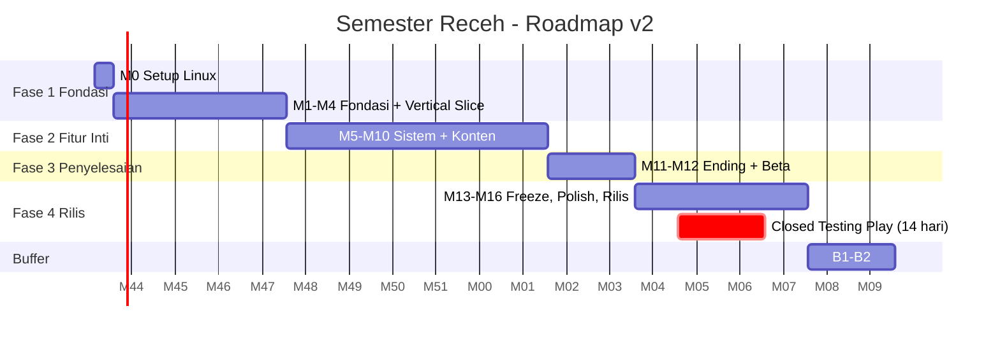

# SEMESTER RECEH — Setup Nol (Linux) & Roadmap Kolaborasi Adil 50:50 (v2.0 Multiplatform)

Dokumen ini adalah **jadwal induk** proyek. Target rilis: **Windows, Linux, dan Android**. Seluruh proses development dilakukan **100% di Linux**. Dev 1 dan Dev 2 sama-sama menulis kode GDScript, membuat model 3D di Blender, menulis dialog/event, **dan memegang satu pipeline platform**.

| Dokumen Pendukung                        | Isi                                                                                                        |
| :--------------------------------------- | :--------------------------------------------------------------------------------------------------------- |
| [[08_mekanik_pindah_kos_jabatan_ending]] | Spesifikasi detail **Pindah Kos**, **Jenjang Jabatan Organisasi**, dan **Sistem Ending**                   |
| [[09_setup_linux_multiplatform]]         | Setup workstation Linux, Android SDK, keystore, export preset, input sentuh, performa, uji platform, rilis |
| [[04_mekanik_sistem_angka]]              | Mekanik inti & tabel angka (kuliah, energi, ekonomi, kantin, dekor, sosial)                                |
|                                          |                                                                                                            |

---

## 0. Perubahan dari Roadmap v1 (12 Minggu, PC Saja)

| Topik | v1 (Lama) | v2 (Sekarang) | Alasan |
| :--- | :--- | :--- | :--- |
| **Platform** | Windows (Linux opsional) | **Windows + Linux + Android** | Target rilis baru |
| **OS development** | Tidak ditentukan | **Linux penuh** (kedua dev) | Keputusan tim |
| **Durasi** | 12 + 2 minggu buffer | **16 + 2 minggu buffer** | Tambahan kontrol sentuh, optimasi mobile, 2 mekanik baru, ending lengkap, dan **Closed Testing Google Play 14 hari** |
| **Godot** | 4.3 | **4.5.x stable atau lebih baru (dikunci di Hari 1)** | Syarat Google Play terbaru, lihat [[09_setup_linux_multiplatform]] §1 |
| **Renderer** | Default (Forward+) | **Compatibility** | Jangkauan Android terluas, tampilan seragam |
| **Mekanik baru** | — | **Pindah Kos** (3 tingkat kos), **Jabatan Organisasi** (6 tingkat), **Ending lengkap** (peringkat + gelar + epilog) | Permintaan desain |
| **Pemilihan Ketua** | Rep ≥ 15 langsung terpilih | Rep ≥ 15 = boleh mencalonkan, menang jika **Skor ≥ 18** | Agar kampanye & teman berpengaruh |
| **Pembagian NPC** | Dev 1: 3 NPC, Dev 2: 4 NPC | **4 : 4** (Pak Pembina ditambahkan, Bagas pindah ke Dev 1) | Adil + Bagas terikat dengan sistem kos |
| **Organisasi** | Dev 1 | **Dev 2** (beserta Sekretariat & Kak Rey) | Dev 1 mengambil sistem Pindah Kos, beban seimbang |

> [!NOTE]
> Bila angka di dokumen lama berbeda dengan dokumen 07/08/09, **yang berlaku adalah dokumen 07/08/09**.

---

## CATATAN PENTING: Alur Pembuatan Aset 3D (Pipeline)
1. **Model Karakter Pemain (True First-Person):** Pemain **memiliki model 3D utuh** (memakai *Base Mesh Humanoid* bersama dari Minggu 3).
   * **Tangan di Layar (First-Person View):** Kedua tangan selalu terlihat santai di bagian bawah pandangan kamera. Tangan berayun saat jalan, menjangkau ke depan saat menekan `E` / interaksi, dan memegang HP saat membuka `Tab`.
   * **Kaki Terlihat Saat Menunduk (*Look-Down Feet*):** Saat kamera dimiringkan (pitch) melihat ke bawah, pemain dapat melihat dada, celana, dan kedua kaki yang melangkah.
   * **Anti-Kliping Kamera (*Head Culling*):** Kepala pemain di-hide/cull khusus untuk kamera pemain agar kamera tidak menembus wajah sendiri, tetapi tubuh & kaki tetap melempar bayangan (*shadow*) utuh di tanah.
   * **Sangat Ringan (Aman untuk Android):** Model low-poly (< 2.500 tris) dengan 1 texture palette hanya memakan 1 draw call, sehingga **sama sekali tidak membebani performa** di Linux, Windows, maupun Android kentang.
2. **Fase Greybox (Minggu 1–2):** Di dua minggu pertama, pemain masih berupa kapsul greybox sederhana untuk mengukur pergerakan. Model fisik pemain mulai dipasang di Minggu 3 bersamaan dengan pembuatan Base Mesh.
3. **NPC dari 1 Base Mesh (Minggu 3):** Dibuat bersama oleh Dev 1 & Dev 2 di Blender, di-rig + animasi `Idle/Walk/Talk` via **Mixamo** (jalan normal di browser Linux). Base mesh ini dipakai untuk **tubuh pemain** sekaligus **semua NPC**.
4. **Semua aset wajib lolos aturan visual** ([[05_ui_ux_audio_visual]] §3.2) **dan anggaran performa Android** ([[09_setup_linux_multiplatform]] §7).
5. **File sumber (`.blend`) disimpan di `art_source/`**, bukan di dalam folder proyek Godot. Hanya `.glb` yang masuk `game/assets/models/`.

---

## BAGIAN 1: Persiapan dari Nol (Minggu 0 — 3 Hari, Dikerjakan Bersama)

Dikerjakan sambil *voice call* Discord. Panduan perintah lengkap ada di [[09_setup_linux_multiplatform]] §2.

### Hari 1 — Workstation Linux
| # | Langkah | Dev 1 | Dev 2 |
| :-: | :--- | :-: | :-: |
| 1 | Install paket sistem: `git`, `git-lfs`, `openjdk-17-jdk`, `wine64`, `scrcpy`, udev rules Android | ✅ | ✅ |
| 2 | Unduh **biner resmi** Godot 4.5.x (versi identik!) + Export Templates | ✅ | ✅ |
| 3 | Unduh Blender 4.2 LTS (tarball resmi) | ✅ | ✅ |
| 4 | Install Android cmdline-tools + SDK via `sdkmanager`, buat `debug.keystore` | ✅ | ✅ |
| 5 | Isi path Java/Android SDK/rcedit/Wine di Godot Editor Settings | ✅ | ✅ |
| 6 | Aktifkan *Developer Options* + *USB Debugging* di HP Android masing-masing, cek `adb devices` | ✅ | ✅ |
| 7 | Buat akun GitHub, itch.io, Mixamo (Adobe) | ✅ | ✅ |

### Hari 2 — Repo & Aturan Main
|  #  | Langkah                                                                                                                      | Pemilik |
| :-: | :--------------------------------------------------------------------------------------------------------------------------- | :-----: |
|  1  | Buat repo `semester-receh` dengan struktur `game/ art_source/ docs/ tools/` ([[09_setup_linux_multiplatform]] §3)            |  Dev 1  |
|  2  | Tulis `.gitattributes` (LF + LFS) dan `.gitignore` (termasuk `*.keystore`)                                                   |  Dev 1  |
|  3  | Buat proyek Godot di `game/`: renderer **Compatibility**, stretch `canvas_items` + `expand`, custom user dir `SemesterReceh` |  Dev 2  |
|  4  | Isi Input Map awal: `move_forward/back/left/right`, `interact`, `phone`, `sprint`, `rotate_item`, `back`, `debug`            |  Dev 2  |
|  5  | Buat `palette_utama.png` (16–24 warna) **bersama**                                                                           | Bersama |
|  6  | Tulis `OWNERSHIP.md` (isi dari Bagian 2.3 dokumen ini) dan aktifkan *branch protection* `main` (wajib PR + 1 review)         |  Dev 1  |
|  7  | Buat GitHub Project (Kanban) dengan kolom: `Backlog · Minggu Ini · Dikerjakan · Review · Selesai`                            |  Dev 2  |

### Hari 3 — "Hello Cube" di 3 Platform
1. **Dev 1** membuat `prop_meja_tes.glb`, **Dev 2** membuat `prop_kursi_tes.glb` (pakai palet). Keduanya masuk ke `test_scene.tscn`.
2. **Dev 1** mengekspor build **Linux** dan **Windows** (`tools/build_all.sh`), lalu menjalankan `.exe` dengan Wine.
3. **Dev 2** mengekspor **Android** debug dan menjalankannya lewat **Remote Deploy** di HP.
4. **Setup selesai jika:** kedua dev melihat meja & kursi satu sama lain di **Linux, Windows (Wine), dan Android**.

---

## BAGIAN 2: Pembagian Peran Adil (50% Coding · 50% Aset · 50% Platform)

### 2.1 Tabel Pembagian Utama
| Kategori | Dev 1 | Dev 2 |
| :--- | :--- | :--- |
| **Core & Autoload** | Player controller & **Rig True First-Person** (tangan di layar, kaki saat menunduk), **`InputRouter`**, Raycast Interaksi, `EventBus`, `SaveManager`, `DialogueRunner`, Debug Menu | `GameState`, `TimeManager`, `Wallet`, `AudioManager`, Transisi Fade & Scene Loader, Siklus Cahaya, **`TouchControls`** |
| **Sistem Gameplay** | Tidur & hari, Ekonomi bulanan (kiriman/tagihan prorata), Jaring Pengaman, Jadwal NPC, BelanjaKu, Mode Dekor, Kenyamanan, **Pindah Kos**, Hati & Chat, Nongkrong, Pacaran-lite, Jurnal, Kucing, **Ending & Rapor Hidup** | Energi & Makan, HUD, Kuliah, Tugas & Tugas Kelompok, Ujian, IPK & App Rapor, Kerja Kantin, App Dompet, Rekap Malam, Kartu Minggu Ini, Event Engine, **Organisasi & Jabatan**, Pekan Raya, **Pemilihan Ketua**, Achievements, Main Menu |
| **UI HP (6 App)** | Chat, BelanjaKu, Lainnya (+ Settings) | Tugas, Dompet, Rapor |
| **Level & Lingkungan** | Kos Bu Tini (lantai 1 + **lantai 2 Kamar Atas**), **Griya Receh**, separuh Taman | Gedung Kelas, Kantin, **Sekretariat**, separuh Taman |
| **NPC (Model + Dialog)** | **Bu Tini, Bagas, Nadia, Pak Pembina** | **Pak Darmawan, Mang Ujang, Kak Rey, Dika** |
| **Perabot BelanjaKu** | 7 barang (#1–7) + bingkai SK* | 8 barang (#8–15) |
| **Event (Data & Teks)** | Event #1, 2, 6, 7, 8, 10, 13, 16, 18, 19 + 4 event kos | Event #3, 4, 5, 9, 11, 12, 14, 15, 17, 20 + 3 event divisi |
| **Pipeline Platform** | **Desktop:** preset Linux & Windows, `build_all.sh`, smoke test Wine, CI GitHub Actions, upload itch.io (`butler`) | **Android:** preset APK/AAB, keystore release, optimasi mobile, Google Play Console, Closed Testing |
| **Rilis** | Trailer + halaman itch.io | Store listing Google Play + screenshot |

\* *Bingkai SK dimodel Dev 1 sebagai "jatah" pengganti Sekretariat yang pindah ke Dev 2.*

### 2.2 Bukti Keadilan: Poin Beban Kerja
**1 poin ≈ ½ hari kerja efektif.** Setiap dev mendapat **10 poin per minggu** pada Minggu 1–12, dan beban polish setara pada Minggu 13–16.

| Fase | Dev 1 — Coding / Aset & Konten / Platform | Dev 2 — Coding / Aset & Konten / Platform |
| :--- | :-: | :-: |
| Fase 1 (M1–4) | **40** = 24 / 15 / 1 | **40** = 23 / 9 / 8 |
| Fase 2 (M5–10) | **60** = 40 / 20 / 0 | **60** = 35 / 25 / 0 |
| Fase 3 (M11–12) | **20** = 19 / 1 / 0 | **20** = 17 / 1 / 2 |
| **Total M1–12** | **120** = 83 / 36 / 1 | **120** = 75 / 35 / 10 |
| Fase 4 (M13–16) | Pipeline desktop, CI, itch.io, uji Windows nyata, trailer | Pipeline Android, AAB, Play Console, Closed Testing, store listing |

*Selisih platform di M1–12 (Dev 2 lebih banyak, karena Android lebih rumit di awal) diimbangi Dev 1 yang memegang lebih banyak coding sistem, lalu Dev 1 memegang beban platform desktop + CI + rilis itch.io di Fase 4.*

> [!TIP]
> Setiap Senin, cek kolom **"Poin Minggu Ini"** di GitHub Project. Jika selisih > 2 poin selama 2 minggu berturut-turut, lakukan **Tukar Tugas** (lihat Bagian 5.3).

### 2.3 Kepemilikan Scene (`OWNERSHIP.md`)
Satu file `.tscn` hanya boleh diedit oleh pemiliknya. Pemilik lain harus izin dulu di Discord.

| Dev 1 | Dev 2 | Bersama (izin dulu!) |
| :--- | :--- | :--- |
| `player.tscn`, `kos.tscn`, `griya_receh.tscn`, `mode_dekor.tscn`, `phone.tscn` (bingkai), `app_chat.tscn`, `app_belanja.tscn`, `app_lainnya.tscn`, `ending_sequence.tscn`, `malam_perpisahan.tscn`, `debug_menu.tscn`, `npc_bu_tini/bagas/nadia/pembina.tscn` | `hud.tscn`, `touch_controls.tscn`, `kelas.tscn`, `kantin.tscn`, `sekretariat.tscn`, `shift_kantin.tscn`, `ujian_ui.tscn`, `rekap_malam.tscn`, `app_tugas/dompet/rapor.tscn`, `main_menu.tscn`, `npc_darmawan/ujang/rey/dika.tscn` | `kampus_luar.tscn` (Taman dibagi: Dev 1 sisi barat, Dev 2 sisi timur, masing-masing sebagai sub-scene `taman_barat.tscn` / `taman_timur.tscn`), `npc_base.tscn`, `project.godot`, `export_presets.cfg` |

---

## BAGIAN 3: Peta Semua Mekanik → Pemilik → Minggu

| # | Mekanik / Sistem | Spesifikasi | Pemilik | Minggu | Dukungan Sentuh |
| :-: | :--- | :--- | :-: | :-: | :--- |
| 1 | Gerak & kamera first-person + **Rig Karakter Pemain** (tangan di layar, kaki saat menunduk) | [[05_ui_ux_audio_visual]] §1.1 | Dev 1 | 1 (controller) → 3 (model/rig) | Joystick + drag (Dev 2, M4) |
| 2 | Interaksi `E` + prompt | [[06_arsitektur_teknis_git]] §4.1 | Dev 1 | 1 | Tombol interaksi berlabel |
| 3 | Waktu, jam, hari, pause | [[04_mekanik_sistem_angka]] §2.2 | Dev 2 | 1 | — |
| 4 | Transisi fade & muat scene | — | Dev 2 | 1 | — |
| 5 | Tidur, ganti hari, pingsan 02:00 | §3.1 Energi | Dev 1 | 2 | — |
| 6 | Uang (`Wallet`) + floating text | §3.2 Ekonomi | Dev 2 | 2 | — |
| 7 | HUD responsif + safe area | [[09_setup_linux_multiplatform]] §5.3 | Dev 2 | 2 | ✅ |
| 8 | Energi & makan | §3.1 | Dev 2 | 2 | — |
| 9 | Bingkai HP (6 App) | [[05_ui_ux_audio_visual]] §2.2 | Dev 1 | 2 | Ikon 📱 |
| 10 | Dialog (Dialogue Manager) | — | Dev 1 | 3 | Tap / tahan |
| 11 | Save/Load v0 → final | [[09_setup_linux_multiplatform]] §6 | Dev 1 | 3 → 12 | Autosave saat app di-pause |
| 12 | Kuliah 3 sikap, bolos, terlambat | §4.1 | Dev 2 | 3 | — |
| 13 | App Tugas + sistem tugas | §4.2 | Dev 2 | 3 | Tahan tombol |
| 14 | Siklus cahaya 4 preset | [[02_karakter_dunia]] §3.3 | Dev 2 | 3 | — |
| 15 | Tutorial Minggu 1 + Tujuan Hari Ini + penanda arah | [[03_cerita_event_humor]] §3 | Dev 1 | 4 | Teks prompt adaptif |
| 16 | Kontrol sentuh (`TouchControls`) | [[09_setup_linux_multiplatform]] §5 | Dev 2 | 4 | ✅ |
| 17 | Ujian (prototipe → lengkap) | §4.3 | Dev 2 | 4 → 9 | Tap |
| 18 | Rekap Malam | §1 Loop Harian | Dev 2 | 4 | Tap lanjut |
| 19 | Kiriman ortu & tagihan kos (prorata) | [[08_mekanik_pindah_kos_jabatan_ending]] A.5 | Dev 1 | 5 | — |
| 20 | Jaring pengaman | §5.1 | Dev 1 | 5 | — |
| 21 | Jadwal NPC (teleport saat tak terlihat) | [[02_karakter_dunia]] §2 | Dev 1 | 5 | — |
| 22 | Kerja part-time kantin | §4.4 | Dev 2 | 5 | Tap item → tap pembeli |
| 23 | App Dompet | — | Dev 2 | 5 | — |
| 24 | App BelanjaKu + paket besok pagi | §4.5 | Dev 1 | 6 | — |
| 25 | Mode Dekor (grid, ghost, putar) | §4.5 | Dev 1 | 6 | Tombol ✔ ⟳ ✖ |
| 26 | Kenyamanan kamar & tingkatnya | §4.5 | Dev 1 | 6 | — |
| 27 | Kartu Minggu Ini | §1 Loop Mingguan | Dev 2 | 6 | — |
| 28 | **Pindah Kos** (3 kos, survei, prorata, kardus pindahan) | [[08_mekanik_pindah_kos_jabatan_ending]] A | Dev 1 | 7–9 | — |
| 29 | **Organisasi: gabung, rapat, reputasi** | 08 B.5 | Dev 2 | 7 | — |
| 30 | **Jabatan: Magang → Anggota → Staf + Divisi** | 08 B.2–B.4 | Dev 2 | 7 | — |
| 31 | Hati & Chat + ngobrol harian | §4.7 | Dev 1 | 8 | — |
| 32 | Nongkrong via Chat | §4.7 | Dev 1 | 8 | — |
| 33 | Proposal revisi + **Koordinator** | §4.6 + 08 B.2 | Dev 2 | 8 | — |
| 34 | Tugas kelompok (3 opsi) | §4.2 | Dev 2 | 9 | — |
| 35 | IPK & App Rapor | §4.1 | Dev 2 | 9 | — |
| 36 | Pacaran-lite (jadian, kencan malam) | §4.7 | Dev 1 | 10 | — |
| 37 | Event Engine + 20 event + 7 event khusus | [[03_cerita_event_humor]] §6 | Dev 2 (engine), Bersama (data) | 10 | Tombol pilihan besar |
| 38 | Pekan Raya: panitia Hari H + lomba makan mi | §4.6 | Dev 2 | 10 | — |
| 39 | Jurnal otomatis + screenshot momen | 08 C.3 | Dev 1 | 10 | — |
| 40 | Kucing kampus | [[02_karakter_dunia]] | Dev 1 (kode + model), Dev 2 (animasi) | 10–12 | — |
| 41 | **Pemilihan Ketua** (calon, kampanye, debat, hasil) | 08 B.6 | Dev 2 | 11 | — |
| 42 | **Malam Perpisahan + Ending lengkap** | 08 C | Dev 1 | 11 | Tap lanjut |
| 43 | Achievements (18) | §5.3 + 08 | Dev 2 | 11 | — |
| 44 | Settings sesuai platform | [[09_setup_linux_multiplatform]] §5.3 | Dev 1 | 12 | ✅ |
| 45 | Main Menu + "Ulangi Malam Terakhir" | 08 C.2 | Dev 2 | 12 | ✅ |
| 46 | Audio (4 musik, 25 SFX, blip) | [[05_ui_ux_audio_visual]] §3.1 | Dev 2 | 12 | — |

**Achievement tambahan (total 18):** #15 **Nomaden** (pindah kos 2×), #16 **Setia Bu Tini** (tidak pernah pindah + Hati Bu Tini ≥ 4), #17 **Naik Pangkat** (mencapai Koordinator), #18 **Wakil Ketua Abadi** (kalah pemilihan).

---

## BAGIAN 4: Roadmap 16 Minggu + 2 Minggu Buffer

*Tanggal di diagram hanya contoh. Ganti dengan tanggal mulai sebenarnya.*

### Milestone & Versi
| Versi        |    Kapan     | Isi                                                                           |
| :----------- | :----------: | :---------------------------------------------------------------------------- |
| `v0.0.1`     |   Akhir M1   | "Hello Kos": jalan + interaksi di 3 platform                                  |
| `v0.1.0`     | **Gate M4**  | **Vertical Slice**: Hari 1–2 dapat dimainkan di 3 platform                    |
| `v0.5.0`     | **Gate M10** | **Alpha**: Hari 1–30 dapat dimainkan, semua sistem kecuali ending & pemilihan |
| `v0.9.0`     | **Gate M12** | **Beta / Content Complete**: 36 hari + ending di 3 platform                   |
| `v1.0.0-rc1` |     M15      | Release Candidate                                                             |
| `v1.0.0`     |   **M16**    | Rilis itch.io (3 platform) + pengajuan Production Google Play                 |

---

### FASE 1: Fondasi & Vertical Slice (Minggu 1–4)

#### Minggu 1 — Gerak, Waktu, Greybox & Pipeline 3 Platform
| Dev 1                                                                                                        |  Poin  | Dev 2                                                                                         |  Poin  |
| :----------------------------------------------------------------------------------------------------------- | :----: | :-------------------------------------------------------------------------------------------- | :----: |
| 💻 `player.tscn`: `CharacterBody3D`, WASD, mouse look, sprint, head-bob (bisa dimatikan)                     |   3    | 💻 `TimeManager.gd`: jam 06:00–02:00, hari 1–36, `pause()`, `skip_hours()`                    |   3    |
| 💻 `InputRouter` (autoload): `get_move_vector()`, `consume_look_delta()`. Player **hanya** membaca dari sini |   2    | 💻 Transisi fade + `SceneLoader` (muat async antar-area lewat pintu)                          |   2    |
| 💻 `Interactable` + raycast + prompt `[E] ...` di layar                                                      |   2    | 🎨 Greybox CSG: kampus luar, gedung kelas, kantin, sekretariat                                |   2    |
| 🎨 Greybox CSG: kos (kamar, lorong, kamar Bagas, rumah Bu Tini), jalan kecil                                 |   2    | 📱 Preset Android debug + Remote Deploy ke HP + **uji renderer Compatibility di HP terlemah** |   2    |
| 🖥️ Preset Linux + Windows, `tools/build_all.sh`, tes `.exe` di Wine                                         |   1    | 💻 Kerangka `GameState.gd` (variabel + `to_dict()`/`from_dict()`)                             |   1    |
| **Total**                                                                                                    | **10** | **Total**                                                                                     | **10** |

**✅ Selesai jika:** pemain bisa jalan dari kos ke kelas (≤ 45 detik), menekan `E` di pintu, dan jam berjalan. Build berjalan di Linux, Wine, dan Android (kontrol sentuh belum ada, cukup terbuka dan tampil).

#### Minggu 2 — Siklus Hari, HUD & Perabot Pertama
| Dev 1 | Poin | Dev 2 | Poin |
| :--- | :-: | :--- | :-: |
| 💻 Kasur: tidur → hitung pemulihan → ganti hari → bangun 06:00; pingsan 02:00 | 2 | 💻 `Wallet.gd`: tambah/kurang/validasi + 10 riwayat transaksi | 2 |
| 💻 Bingkai HP `phone.tscn` (tab 6 App, `Esc`/Back kembali), responsif 16:9 – 20:9 | 3 | 💻 `hud.tscn` responsif + safe area + floating text (`+Rp 80.000`) | 3 |
| 💻 Finalisasi `EventBus.gd` (daftar signal disepakati berdua) | 1 | 💻 Sistem energi + makan (warung, mi instan di kos), efek ngantuk < 20 | 2 |
| 🎨 Model: **Kasur Lipat, Meja Belajar, Kursi** | 3 | 🎨 Model: **Meja Kelas, Kursi Kuliah, Papan Tulis, Meja Dosen** | 3 |
| 💻 Debug Menu (`F1` / tap 3 jari): `skip_to_day`, `money_add`, `energy_set` | 1 | | |
| **Total** | **10** | **Total** | **10** |

#### Minggu 3 — Base Mesh (NPC & Player), Karakter Pemain, Dialog, Kuliah
**Bersama (2 poin masing-masing):** Buat 1 Base mesh tubuh manusia low-poly (< 3.000 tris) di Blender. Upload ke Mixamo dan download animasi: `Idle`, `Walk`, `Talk`, serta animasi First-Person (`FP_Walk`, `FP_Idle`, `Interact_Reach`). Base mesh ini menjadi pondasi **seluruh NPC dan Karakter Pemain**.

| Dev 1 | Poin | Dev 2 | Poin |
| :--- | :-: | :--- | :-: |
| 🤝 Base mesh tubuh manusia bersama | 2 | 🤝 Base mesh tubuh manusia bersama | 2 |
| 🎨 **Model Karakter Pemain** (`player_body.glb`): variasi base mesh berkaos santai, celana jeans & sneakers. Pasang ke `player.tscn`, atur *head-culling* agar kepala tidak kliping di kamera; tangan & kaki tampak utuh | 2 | 💻 Sistem Kelas: jadwal, 3 sikap (Fokus/Santai/Tidur), risiko ketahuan 40%, bolos, terlambat | 3 |
| 💻 `DialogueRunner` + kotak dialog (nama, 2 baris, blip), tap/E lanjut, tahan = cepat, waktu berhenti | 2 | 💻 App Tugas: jadwal hari ini + daftar tugas + deadline | 2 |
| 💻 `SaveManager` v0: JSON + `save_version` + tulis `.tmp` lalu rename | 3 | 🎨 NPC **Pak Darmawan** (batik, kacamata) + taruh di kelas | 2 |
| 🎨 NPC **Bu Tini** (daster, sanggul) + taruh di kos | 1 | 💻 4 preset cahaya (pagi/siang/sore/malam) terhubung ke `TimeManager` | 1 |
| **Total** | **10** | **Total** | **10** |

#### Minggu 4 — Tutorial, Animasi Tangan/Kaki, Kontrol Sentuh & VERTICAL SLICE
| Dev 1 | Poin | Dev 2 | Poin |
| :--- | :-: | :--- | :-: |
| 💻 Tutorial Hari 1–4 (Bu Tini & Bagas) + baris "Tujuan Hari Ini" + penanda arah | 3 | 📱 `touch_controls.tscn`: joystick dinamis, drag look, tombol Interaksi (label prompt), Sprint, HP, Pause; terhubung ke `InputRouter` | 4 |
| 💻 **Animasi Tubuh Pemain:** integrasi ayunan tangan di kamera saat jalan, tangan meraih saat interaksi `E`, dan langkah kaki saat pitch kamera ke bawah | 1 | 💻 Prototipe Ujian (5 soal pilihan ganda, tap/klik) | 2 |
| 🎨 Dinding & lantai modular kos lantai 1 (ganti CSG) | 3 | 💻 Layar Rekap Malam (ringkasan + perubahan angka + teaser besok) | 2 |
| 🎨 NPC **Bagas** (gondrong, jaket) + dialog dasar | 3 | 📱 Performance pass 1 di HP (Profiler, Remote Debug, render scale) | 2 |
| **Total** | **10** | **Total** | **10** |

> [!IMPORTANT]
> **🎯 GATE M4 — Vertical Slice `v0.1.0`**
> Hari 1–2 dapat dimainkan: bangun (tangan & kaki pemain terlihat saat menunduk) → kenalan Bu Tini → buka HP → jalan ke kelas (kaki melangkah & tangan berayun halus) → ikut kelas Pak Darmawan → ngobrol Bagas → makan → tidur → rekap → save/load.
> Wajib lolos **Checklist per Gate** ([[09_setup_linux_multiplatform]] §8) di **Linux, Windows nyata, dan 2 HP Android** (≥ 30 FPS di HP lemah).
> Jika gagal: Minggu 5 dipakai untuk perbaikan dan seluruh jadwal mundur 1 minggu (memakan buffer).

---

### FASE 2: Fitur Inti & Konten Dunia (Minggu 5–10)

#### Minggu 5 — Ekonomi Bulanan & Kerja Kantin
| Dev 1 | Poin | Dev 2 | Poin |
| :--- | :-: | :--- | :-: |
| 💻 Kiriman ortu (Hari 1 & 19) + tagihan kos (Hari 18 & 36) **memakai riwayat kos (prorata-ready)** | 2 | 💻 Mini-game Shift Kantin: 8 pembeli, 1–2 item, tips Rp0–40.000, mouse **dan** tap | 4 |
| 💻 Jaring pengaman: mi gratis Bu Tini, telepon Ibu Rp200.000 | 2 | 🎨 NPC **Mang Ujang** (topi, handuk leher) | 2 |
| 💻 `ScheduleData` + teleport NPC saat tidak terlihat kamera | 2 | 🎨 Bangunan Kantin + prop mangkok, gelas, gorengan | 3 |
| 🎨 Model: **Lampu Belajar, Rak Buku, Karpet, Kasur Busa** | 4 | 💻 App Dompet (saldo, 10 transaksi, info tagihan) | 1 |
| **Total** | **10** | **Total** | **10** |

#### Minggu 6 — BelanjaKu, Dekorasi & Kartu Mingguan
| Dev 1 | Poin | Dev 2 | Poin |
| :--- | :-: | :--- | :-: |
| 💻 App BelanjaKu (katalog `ItemData`, beli, paket tiba besok pagi di depan kamar kos aktif) | 3 | 💻 Kartu Minggu Ini (3 target opsional + bonus) | 2 |
| 💻 Mode Dekor: grid 0,25 m, ghost hijau/merah, putar 90°, ambil kembali; **versi mouse + tombol sentuh ✔ ⟳ ✖** | 5 | 🎨 Model **8 perabot**: Tanaman, Poster (3 var), Lampu Tumblr, Kipas, Komputer, Bean Bag, Lemari, Jam Dinding | 5 |
| 💻 Hitung kenyamanan + 4 tingkat + **batas kenyamanan per kos** | 2 | 🎨 Interior final **Sekretariat** (tumpukan kertas, banner gulung, papan struktur organisasi) | 3 |
| **Total** | **10** | **Total** | **10** |

#### Minggu 7 — Pindah Kos I & Organisasi I
| Dev 1 | Poin | Dev 2 | Poin |
| :--- | :-: | :--- | :-: |
| 💻 `KosData` + sistem pindah: jadwal eksekusi besok pagi, Kardus Pindahan, batas 2×, jendela Hari 13–33, rumus prorata ([[08_mekanik_pindah_kos_jabatan_ending]] A) | 5 | 💻 Organisasi inti: gabung (Minggu 2), rapat Rabu Bertahan/Kabur, sumber reputasi, `JabatanData`, promosi **Magang → Anggota Tetap → Staf**, SK sebagai barang dekor | 5 |
| 🎨 Kos **lantai 2 + Kamar Atas** (tangga, jendela besar) | 3 | 🎨 NPC **Kak Rey** (jaket almamater) | 2 |
| 💻 Hati Bu Tini + event tawaran "Kamar atas kosong, Nak" | 2 | 💻 Pilih divisi (Acara/Humas/Logistik) + 3 tugas divisi | 3 |
| **Total** | **10** | **Total** | **10** |

#### Minggu 8 — Sosial & Organisasi II
| Dev 1 | Poin | Dev 2 | Poin |
| :--- | :-: | :--- | :-: |
| 💻 App Chat + sistem Hati (0–5, +0,5 ngobrol harian, beri makanan) | 4 | 💻 Siklus Proposal Pekan Raya (3–5 revisi acak, sesi laptop) | 3 |
| 🎨 NPC **Nadia** | 2 | 💻 Promosi **Koordinator** + keuntungan (honor Rp75.000, delegasi 1 aksi) | 2 |
| 💻 Nongkrong via Chat (pilih NPC → lokasi → langsung bertemu, 2 jam, Rp25.000) | 3 | 🎨 Gedung Kelas final (dinding modular, koridor, ruang dosen) | 3 |
| 💻 Papan Iklan Kos di gerbang + kartu perbandingan survei | 1 | 🎨 Taman timur: bangku + pohon (`MultiMeshInstance3D`) | 2 |
| **Total** | **10** | **Total** | **10** |

#### Minggu 9 — Kos Elit & Akademik Lengkap
| Dev 1 | Poin | Dev 2 | Poin |
| :--- | :-: | :--- | :-: |
| 🎨 **Griya Receh**: fasad di dekat gerbang + lobi + kamar 5×4 m (AC) | 4 | 💻 Ujian lengkap: bank soal UTS/UAS, timer 15 detik (bisa dimatikan), Hint 50:50 otomatis | 4 |
| 💻 4 event khusus kos + jaring pengaman "mi via ojol" untuk Griya | 2 | 💻 Tugas Kelompok (3 opsi, anggota menghilang) | 2 |
| 🎨 NPC **Pak Pembina** (variasi base mesh, kemeja rapi + map) | 2 | 🎨 NPC **Dika** (kaos seni, gelang) | 2 |
| 🎨 Taman barat: lampu taman, tong sampah, mading, banner | 2 | 💻 Rumus IPK + App Rapor (rincian nilai, Reputasi, Jurnal) | 2 |
| **Total** | **10** | **Total** | **10** |

#### Minggu 10 — Event Engine, Pekan Raya & Romansa
| Dev 1 | Poin | Dev 2 | Poin |
| :--- | :-: | :--- | :-: |
| 💻 Pacaran-lite: event "Ajak Jadian" (5 hati, Minggu ≥ 5) + "Kencan di Taman Malam" | 3 | 💻 Event Engine: aturan maks 1 negatif/hari, min 1 positif/2 hari, tidak ada event di hari ujian, pool event sesuai kos aktif | 3 |
| ✍️ 10 file `EventData.tres` jatah Dev 1 (teks + efek) | 3 | ✍️ 10 file `EventData.tres` jatah Dev 2 + 3 event divisi | 3 |
| 💻 Jurnal otomatis + screenshot momen (480×270 ke `user://jurnal/`) | 2 | 💻 Pekan Raya Hari H: aksi panitia (Banner/Registrasi/MC + bonus divisi) + lomba makan mi | 4 |
| 💻 Kucing kampus: spawner saat stres + elus (+10 energi, koleksi foto) | 2 | | |
| **Total** | **10** | **Total** | **10** |

> [!IMPORTANT]
> **🎯 GATE M10 — Alpha `v0.5.0`**
> Hari 1–30 bisa dimainkan tanpa debug: semua sistem di Bagian 3 baris #1–#40 aktif. Pindah kos ke 3 kos berhasil, jabatan bisa naik sampai Koordinator, 27 event muncul sesuai aturan.
> Lolos checklist 3 platform. **Mulai hari ini, tidak ada sistem baru di luar daftar Bagian 3.**

---

### FASE 3: Ending, Pemilihan & Konten Lengkap (Minggu 11–12)

#### Minggu 11 — Ending & Pemilihan Ketua
| Dev 1 | Poin | Dev 2 | Poin |
| :--- | :-: | :--- | :-: |
| 💻 `malam_perpisahan.tscn`: NPC hadir sesuai hati ≥ 2, dialog penutup, pasangan di bangku, hook pelantikan | 3 | 💻 Pendaftaran calon (Hari 31) + aksi kampanye (poster, dukungan teman) | 3 |
| 💻 `EndingCalculator.gd` (fungsi murni) + layar **Rapor Hidup** S/A/B/C | 3 | 💻 Debat kandidat (3 pertanyaan, maks +2 suara) | 2 |
| 💻 Montase Jurnal + Peringkat Ending + Gelar + layar epilog (Janji, Romansa, Kos, Organisasi) | 4 | 💻 Pengumuman hasil (Hari 35) + Bambang + gelar "Wakil Ketua Abadi" | 2 |
| | | 💻 Sistem Achievements (18) + popup + daftar di HP | 3 |
| **Total** | **10** | **Total** | **10** |

**Penulisan teks ending dibagi sesuai [[08_mekanik_pindah_kos_jabatan_ending]] C.4** (dikerjakan di sela-sela, tidak dihitung poin karena seimbang 50:50).

#### Minggu 12 — Save Final, Menu, Audio & BETA
| Dev 1 | Poin | Dev 2 | Poin |
| :--- | :-: | :--- | :-: |
| 💻 `SaveManager` final: migrasi `save_version`, autosave pagi & tidur, **autosave saat app Android di-pause**, `save_pre_ending` | 4 | 💻 Main Menu (Lanjut, Baru, **Ulangi Malam Terakhir**, Settings, Credits, Keluar) + badge peringkat ending | 2 |
| 💻 Settings platform-aware (desktop: fullscreen/VSync/FPS; Android: render scale, ukuran & opasitas kontrol sentuh; semua: FOV, sensitivitas, head-bob, ukuran teks, volume) | 3 | 🎵 `AudioManager`: 4 musik lo-fi crossfade + ± 25 SFX terpasang | 4 |
| 💻 Layar Statistik Lucu + Credits | 2 | 🎵 Blip dialog per NPC (pitch berbeda) | 1 |
| 🎨 Model Kucing Kampus | 1 | 🎨 Animasi Kucing (idle, duduk, jalan) | 1 |
| | | 📱 Ikon adaptif Android + splash + ikon `.ico` Windows (rcedit) | 2 |
| **Total** | **10** | **Total** | **10** |

> [!IMPORTANT]
> **🎯 GATE M12 — Beta `v0.9.0` (Content Complete)**
> 36 hari + semua ending dapat diselesaikan di **3 platform**. Uji cepat semua 5 peringkat ending lewat debug `ending_preview`. **Mulai hari ini: FEATURE FREEZE & ASSET FREEZE.**

---

### FASE 4: Freeze, Polish & Rilis (Minggu 13–16)

#### Minggu 13 — Balancing & Rotasi Platform
| Dev 1 | Dev 2 |
| :--- | :--- |
| ⚖️ **Lead balancing:** ekonomi, harga perabot, sewa kos, tagihan prorata, hati & sosial | ⚖️ **Lead balancing:** energi, nilai & IPK, reputasi & skor pemilihan, frekuensi event |
| 🔄 **Rotasi platform:** Dev 1 membuat build **Android** sendiri dan menguji di HP | 🔄 **Rotasi platform:** Dev 2 membuat build **Windows** sendiri dan mengujinya di **PC Windows nyata** |
| 🐞 Bugfix dari playtest | 🐞 Bugfix dari playtest + cek ulang aturan Google Play terbaru |

**Playtest bersama:** minimal 5 orang (2 Windows, 1 Linux, 2 Android). Pakai Google Form: *"Kapan bingung? Kapan bosan? Kapan ketawa?"*
**Spreadsheet balancing** wajib memuat simulasi 4 gaya main (Rajin, Gaul, Mandiri, Organisasi) dan memastikan **tiap Janji Semester bisa dicapai** dalam 1 playthrough normal.

#### Minggu 14 — Optimasi & Mulai Closed Testing Google Play
| Dev 1 | Dev 2 |
| :--- | :--- |
| 🖥️ Optimasi desktop (iGPU 60 FPS), cek resolusi ultrawide/16:10 | 📱 Optimasi Android (MultiMesh, matikan bayangan prop kecil, cek draw call < 150) |
| 🖥️ CI GitHub Actions (tag-only) + `publish_itch.sh` + halaman itch.io **restricted** untuk tester | 📱 Build **AAB** (Gradle build), Play Console: buat app, Data Safety, rating konten, kebijakan privasi |
| 🐞 Bugfix | 📱 **Mulai Closed Testing paling lambat Senin M14** (≥ 12 tester, 14 hari berturut-turut) |

> [!WARNING]
> Closed Testing **harus mulai di awal M14** agar 14 hari selesai sebelum M16. Rekrut 12+ tester sejak M12 (teman kampus, komunitas game dev). Tester harus tetap ikut (opt-in) selama 14 hari penuh.

#### Minggu 15 — Polish & Materi Rilis (`v1.0.0-rc1`)
| Dev 1 | Dev 2 |
| :--- | :--- |
| ✨ Polish visual kos, Griya, taman barat (detail kecil, lampu malam hangat) | ✨ Polish visual kelas, kantin, sekre, taman timur |
| ✨ UI juice: animasi buka HP, bounce tombol, transisi rapor | ✨ Audio mix final, cek volume blip di speaker HP |
| 🎬 Trailer 60 detik (OBS di Linux + `scrcpy` untuk cuplikan Android) + halaman itch.io | 🛒 Store listing Google Play: ikon 512 px, feature graphic 1024×500, 6–8 screenshot HP |
| 🐞 Bugfix kritis saja | 🐞 Bugfix kritis saja + update build Closed Testing |

#### Minggu 16 — RILIS `v1.0.0` 🎉
| Hari | Dev 1 | Dev 2 |
| :-: | :--- | :--- |
| Senin–Selasa | Verifikasi final build Linux & Windows (PC nyata) | Verifikasi final AAB/APK di 2 HP |
| Rabu | `butler push` 3 platform ke itch.io → **Public** | Ajukan **Production** di Play Console (review bisa beberapa hari) |
| Kamis–Jumat | Posting rilis (Twitter/X, Reddit r/godot & r/indiegaming, grup kampus) | Pantau crash (Android vitals), siapkan hotfix |

#### Buffer B1–B2
Untuk keterlambatan Gate, waktu review Google Play, dan **hotfix `v1.0.1`**. Jika tidak terpakai: tambah 5 event baru atau dukungan gamepad penuh (Steam Deck).

---

## BAGIAN 5: Ritual Kerja & Aturan Keadilan

### 5.1 Ritme Mingguan
| Hari | Kegiatan | Durasi |
| :--- | :--- | :-: |
| **Senin** | Planning: ambil kartu minggu ini di GitHub Project, cek poin seimbang | 30 menit |
| **Rabu** | Sync singkat: blocker? perlu ubah `project.godot`? | 15 menit |
| **Jumat** | **Platform Day:** build 3 platform, uji di HP & Wine, demo hasil kerja ke pasangan, merge PR | 1–2 jam |
| **Minggu** | Libur (wajib, cegah burnout) | — |

### 5.2 Definition of Done (Setiap Fitur)
Sebuah kartu baru boleh dipindah ke **Selesai** jika:
- [ ] Berfungsi dengan **keyboard/mouse dan sentuh** (jika fitur punya input)
- [ ] Diuji minimal sekali di **HP Android** (Remote Deploy)
- [ ] Data baru **tersimpan & termuat** di `SaveManager`
- [ ] Ada **perintah debug F1** untuk mengetes fitur dengan cepat
- [ ] Nama file huruf kecil snake_case, tidak ada error di Output
- [ ] PR direview & di-merge oleh **pasangan**

### 5.3 Aturan Keadilan
1. **Seimbang 10 : 10 poin per minggu** (M1–M12). Dicatat di GitHub Project.
2. **Tukar Tugas, bukan Lempar Tugas:** jika satu dev tertinggal, tukar kartu dengan poin **setara**. Tidak boleh hanya "menitipkan" kartu.
3. **Setiap minggu, setiap dev menyentuh coding DAN aset/konten.** Tidak ada minggu yang 100% coding atau 100% modeling.
4. **Setiap dev memegang 1 pipeline platform** dan wajib mencoba pipeline pasangannya di **M13 (Rotasi)**.
5. **Review silang:** semua PR dicek pasangan, agar keduanya paham seluruh codebase.
6. **Kredit setara:** nama di Credits, store, dan portofolio ditulis *"Dibuat oleh Dev 1 & Dev 2"* (urut abjad).

### 5.4 Aturan Git Tambahan untuk Lingkungan Linux
* Branch: `dev1/<fitur>`, `dev2/<fitur>`. Tag rilis: `v0.1.0`, dst.
* `git config --global core.autocrlf input` (kedua laptop), agar file selalu LF.
* Sebelum mengubah `project.godot` (autoload, input map, layer), umumkan di Discord → commit kecil terpisah → push segera.
* `export_presets.cfg` hanya diedit oleh **pemilik pipeline**: preset desktop oleh Dev 1, preset Android oleh Dev 2.

---

## BAGIAN 6: Daftar Perintah Debug (F1 / Tap 3 Jari)

| Perintah | Fungsi | Pembuat |
| :--- | :--- | :-: |
| `skip_to_day <n>` / `time_set <hh:mm>` | Lompat hari/jam | Dev 2 |
| `money_add <n>` / `energy_set <n>` | Ubah uang/energi | Dev 2 |
| `hati_set <npc> <n>` | Ubah hati NPC | Dev 1 |
| `kos_set <petak\|atas\|griya>` / `kos_tagihan_preview` | Tes pindah kos & tagihan | Dev 1 |
| `rep_set <n>` / `jabatan_set <0-6>` / `pemilihan_sim` | Tes organisasi | Dev 2 |
| `event_force <id>` | Paksa event tertentu | Dev 2 |
| `item_give <id>` / `comfort_dump` | Tes dekor & kenyamanan | Dev 1 |
| `ipk_set <x>` | Tes rapor & ending | Dev 2 |
| `ending_preview <S\|A\|B\|C\|abadi>` / `ending_dump` | Tes semua ending | Dev 1 |
| `fps` / `touch_force on\|off` | Overlay performa / paksa kontrol sentuh di desktop | Dev 2 |

*Menu debug otomatis tidak ikut di build rilis (`OS.is_debug_build()`).*

---

## BAGIAN 7: Risiko & Mitigasi

| Risiko | Dampak | Mitigasi | Pemilik |
| :--- | :--- | :--- | :-: |
| Performa buruk di HP lemah | Game tidak layak di Android | Renderer Compatibility, anggaran segitiga/draw call, uji tiap Jumat sejak M1 | Dev 2 |
| Tidak punya PC Windows | Bug khusus Windows lolos | Wine untuk smoke test + PC nyata di setiap Gate (teman/lab/dual-boot) | Dev 1 |
| *Case mismatch* nama file | Crash di Windows/Android, aman di Linux | Aturan snake_case huruf kecil, cek log saat Gate | Bersama |
| Keystore release hilang | Update Play Store tertunda | Simpan di 2 tempat, Play App Signing aktif, jangan pernah di-commit | Dev 2 |
| Closed Testing Play kurang tester | Rilis Android mundur | Rekrut sejak M12, siapkan 15–20 calon tester | Dev 2 |
| Kuota Git LFS habis | Tidak bisa push/pull aset | CI hanya saat tag, kompres tekstur, pantau kuota bulanan | Dev 1 |
| Scope creep (mekanik baru) | Tidak selesai | Feature freeze di Gate M10 (sistem) dan M12 (aset) | Bersama |
| Pindah Kos merusak dekor/save | Progres hilang | Semua perabot ke Kardus Pindahan, save `.tmp` → rename, tes `kos_set` tiap Jumat | Dev 1 |
| Versi Godot berbeda antar-laptop | File `.tscn` rusak/berubah massal | Versi dikunci, cek `godot --version` di Platform Day | Bersama |
| Masalah Wayland/driver di Linux | Editor crash | Jalankan Godot via X11 (`--display-driver x11`) jika perlu, update driver Mesa | Masing-masing |

---

## BAGIAN 8: Ringkasan Kapan Aset Dibuat

| Minggu | Dev 1 | Dev 2 |
| :-: | :--- | :--- |
| 1 | Greybox kos | Greybox kampus, kelas, kantin, sekre |
| 2 | Kasur Lipat, Meja Belajar, Kursi | Meja Kelas, Kursi Kuliah, Papan Tulis, Meja Dosen |
| 3 | 🤝 Base mesh · **Karakter Pemain (Badan/Tangan/Kaki)** · **Bu Tini** | 🤝 Base mesh · **Pak Darmawan** |
| 4 | Modular kos lantai 1 · **Bagas** | — (fokus kontrol sentuh) |
| 5 | Lampu Belajar, Rak Buku, Karpet, Kasur Busa | **Mang Ujang** · Bangunan Kantin + prop |
| 6 | — (fokus Mode Dekor) | 8 perabot BelanjaKu · Sekretariat final |
| 7 | Kos lantai 2 / **Kamar Atas** | **Kak Rey** |
| 8 | **Nadia** | Gedung Kelas final · Taman timur |
| 9 | **Griya Receh** · **Pak Pembina** · Taman barat | **Dika** |
| 10 | — (fokus event & romansa) | — (fokus event & Pekan Raya) |
| 11 | Bingkai SK (4 label) | — |
| 12 | Model Kucing | Animasi Kucing · Ikon & splash |
| 13+ | 🔒 **Asset freeze**: hanya polish | 🔒 **Asset freeze**: hanya polish |