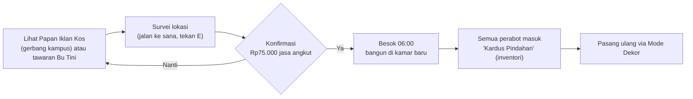
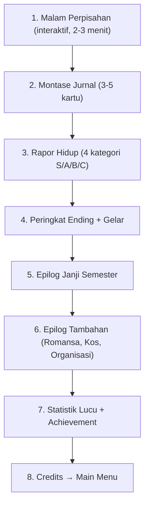

# SEMESTER RECEH — Spesifikasi Detail: Pindah Kos, Jabatan Organisasi & Ending

Dokumen ini melengkapi [[04_mekanik_sistem_angka]] dan [[03_cerita_event_humor]]. Jika ada angka yang bertabrakan, **dokumen ini yang berlaku** (versi lebih baru).

> [!IMPORTANT]
> Semua mekanik di sini tetap wajib lolos **Prinsip Anti-Ribet** ([[01_visi_prinsip_desain]]): maksimal 3 langkah input, tanpa game over, tanpa hukuman berat, dan bisa dimainkan dengan **mouse/keyboard maupun layar sentuh (Android)**.

---

## BAGIAN A — Mekanik Pindah Kos

### A.1 Tujuan Desain
* Memberi **tujuan jangka menengah** untuk uang (selain dekorasi).
* Membuat target **"Kos Sultan" (Kenyamanan ≥ 40)** terasa sebagai hasil kerja keras: kamar awal terlalu kecil untuk mencapainya.
* Memberi pilihan nyata: **pindah = nyaman dan dekat kampus, tetapi lebih mahal dan jauh dari Bagas & Bu Tini.**

### A.2 Tiga Pilihan Kos
| Atribut | 🏠 Kamar Petak Bu Tini (Awal) | 🏠 Kamar Atas Bu Tini | 🏢 Griya Receh Residence |
| :--- | :--- | :--- | :--- |
| **Sewa / bulan** | Rp400.000 | Rp600.000 | Rp950.000 |
| **Ukuran grid dekor** | 3 × 3 m (12 × 12 sel) | 4 × 3,5 m (16 × 14 sel) | 5 × 4 m (20 × 16 sel) |
| **Batas maks Kenyamanan** | 28 poin | 42 poin | 50 poin |
| **Bonus pasif** | — | Jendela besar: bangun pagi **+5 Energi** | AC: pemulihan tidur **+5%** (ditumpuk dengan bonus kenyamanan) |
| **Jarak ke kelas (jalan kaki)** | ± 45 detik | ± 50 detik (ada tangga) | ± 15 detik (depan gerbang kampus) |
| **Peluang event "WiFi mati"** | 25% / hari | 15% / hari | 0% (WiFi kencang) |
| **Tetangga** | Bagas (sebelah kamar) | Bagas (lantai bawah) | Tidak ada; event Bagas lebih jarang |
| **Jaring pengaman uang tipis** | Mi gratis dari Bu Tini | Mi gratis dari Bu Tini | Bu Tini kirim mi via ojol *("Ibu tetap peduli, Nak.")* |
| **Event unik** | "Atap bocor saat hujan" | "Jemuran terbang ke genteng" | "Grup WA penghuni ribut", "Paket nyasar" |
| **Syarat** | — | Hati Bu Tini ≥ 2 **dan** sudah tinggal ≥ 12 hari | Survei lokasi + uang ≥ Rp1.025.000 (sewa + angkut) saat konfirmasi |

> [!NOTE]
> Perhitungan "Kos Sultan" (≥ 40) hanya bisa dicapai di Kamar Atas atau Griya Receh. Gelar "Estetik" (25+) untuk Janji **Anak Mandiri** tetap bisa dicapai di Kamar Petak.

### A.3 Alur Pindah Kos (Maksimal 3 Langkah)


1. **Temukan:** Papan Iklan Kos di gerbang kampus (interaksi `E` / tap) menampilkan kos yang tersedia. Kamar Atas juga ditawarkan lewat event Bu Tini *"Kamar atas kosong, Nak. Mau?"* saat syaratnya terpenuhi.
2. **Survei:** Untuk Griya Receh, pemain harus datang ke lokasinya sekali (pemicu `Interactable` "Lihat Kamar"). Muncul kartu perbandingan: **Sewa, Ukuran, Jarak, Bonus** (maks 4 baris).
3. **Konfirmasi:** Bayar **Rp75.000 jasa angkut** (*"Pickup sepupunya Bagas, bensin ditanggung kamu."*). Pindah dieksekusi **besok pagi pukul 06:00** (sama seperti paket BelanjaKu, agar tidak ada transisi di tengah hari).

### A.4 Aturan Pindah
| Aturan | Nilai |
| :--- | :--- |
| **Jendela pindah** | Terbuka mulai **Hari 13** (awal Minggu 3), tutup setelah **Hari 33** |
| **Maksimal pindah** | **2 kali per semester** (cukup untuk naik lalu balik, atau naik 2 tingkat) |
| **Tidak bisa dieksekusi** | Pada pagi hari UTS/UAS atau Hari H Pekan Raya (diundur otomatis ke hari berikutnya) |
| **Turun kelas kos** | Boleh (misalnya Griya → Kamar Petak). Bu Tini: *"Kok balik? Nggak betah sama yang mahal ya?"* (+0,5 hati Bu Tini) |
| **Perabot** | Semua perabot otomatis masuk **Kardus Pindahan** (inventori dekor). Tidak ada barang yang hilang. |
| **Paket BelanjaKu** | Selalu dikirim ke kos aktif saat pagi pengantaran |
| **Tagihan kos** | Dihitung **prorata otomatis** berdasarkan hari tinggal (lihat A.5) |

### A.5 Rumus Tagihan Prorata (Anti-Eksploitasi)
Agar pemain tidak bisa tinggal di Griya Receh lalu pindah ke kamar murah sehari sebelum tagihan:

$$\text{Tagihan} = \sum_{k} \text{Sewa}_k \times \frac{\text{Hari tinggal di kos } k \text{ dalam periode}}{18}$$

* Periode 1 = Hari 1–18 (ditagih Hari 18), Periode 2 = Hari 19–36 (ditagih Hari 36).
* Pemain **hanya melihat satu angka** di App Dompet: *"Tagihan kos berikutnya: Rp683.333 (Hari 18)"*. Rumus tidak ditampilkan.
* Dibulatkan ke ribuan terdekat agar mudah dibaca.

### A.6 Dampak ke Sistem Lain
| Sistem | Dampak |
| :--- | :--- |
| **Energi** | Bonus pasif kos (A.2) + bonus kenyamanan kamar |
| **Dekor** | Grid & batas kenyamanan mengikuti kos aktif |
| **Sosial** | Di Griya Receh, ngobrol harian dengan Bagas butuh jalan ke kos Bu Tini; event Bagas turun dari 30% ke 10% per hari |
| **Event** | Pool event kos berganti sesuai kos aktif |
| **Ending** | Memengaruhi kategori **Dompet**, gelar kos, dan 1 kartu epilog |
| **Achievement** | "Nomaden" (pindah 2×), "Setia Bu Tini" (tidak pernah pindah) |

### A.7 Spesifikasi Teknis (untuk Dev 1)
```gdscript
# res://scripts/core/kos_data.gd
class_name KosData extends Resource

@export var id: StringName              # &"petak", &"atas", &"griya"
@export var nama: String
@export var sewa_per_bulan: int = 400000
@export var scene_kamar: PackedScene    # sub-scene kamar (berisi node DecorGrid + SpawnPoint)
@export var grid_size: Vector2i = Vector2i(12, 12)
@export var batas_kenyamanan: int = 28
@export var bonus_energi_bangun: int = 0
@export var bonus_pulih_tidur: float = 0.0
@export var peluang_wifi_mati: float = 0.25
@export var event_unik: Array[Resource] = []   # EventData khusus kos ini
```

**Data di `GameState` (disimpan di save):**
```gdscript
var kos_aktif: StringName = &"petak"
var riwayat_kos: Array[Dictionary] = [{"kos": &"petak", "hari_mulai": 1}]
var jumlah_pindah: int = 0
var pindah_terjadwal: StringName = &""   # dieksekusi saat day_started
var dekor_terpasang: Array[Dictionary] = []  # {item_id, cell, rotasi} untuk kos aktif saja
```

**Signal baru di `EventBus`:** `kos_moved(from_id, to_id)`, `rent_due(amount)`.

**Struktur level:**
* `kos.tscn` (Dev 1) berisi lantai 1 (Kamar Petak, kamar Bagas, ruang bersama) **dan** lantai 2 (Kamar Atas). Satu bangunan, dua kamar pemain.
* `griya_receh.tscn` (Dev 1) berisi lobi kecil + 1 kamar. Fasadnya ditaruh di `kampus_luar.tscn` dekat gerbang.

### A.8 Debug Command (F1)
`kos_set <petak|atas|griya>`, `kos_reset_pindah`, `kos_tagihan_preview`.

---

## BAGIAN B — Jenjang Jabatan Organisasi (Himpunan Mahasiswa)

### B.1 Tujuan Desain
Plan lama hanya punya "gabung → Rep ≥ 15 → ketua". Sekarang progres organisasi dibuat **bertangga**, sehingga pemain merasakan naik jabatan setiap 1–2 minggu, dan setiap jabatan memberi **keuntungan kecil yang terasa**.

### B.2 Tangga Jabatan
| Tingkat | Jabatan | Syarat Naik | Biasanya Tercapai | Keuntungan |
| :-: | :--- | :--- | :-: | :--- |
| 0 | Bukan Anggota | — | Minggu 1 | — |
| 1 | **Anggota Magang** | Terima ajakan Kak Rey | Minggu 2 | Boleh ikut rapat; **snack rapat +5 Energi** |
| 2 | **Anggota Tetap** | Reputasi ≥ 4 **dan** hadir (bertahan) ≥ 1 rapat | Minggu 2–3 | **Kunci Sekretariat**: tempat kerja tugas ber-WiFi kencang (tanpa risiko event WiFi mati) |
| 3 | **Staf Divisi** | Reputasi ≥ 8 → pilih 1 dari 3 divisi | Minggu 3 | Slot **target organisasi** di Kartu Minggu Ini (+1 Rep jika selesai) |
| 4 | **Koordinator Divisi** | Reputasi ≥ 12 **dan** proposal Pekan Raya disetujui | Minggu 4–5 | **Honor Rp75.000** setelah Hari H; boleh **delegasi 1 aksi panitia** (tanpa biaya energi) |
| 5 | **Calon Ketua** | Staf/Koordinator **dan** Reputasi ≥ 15 pada pendaftaran Hari 31 | Minggu 6 | Akses aksi kampanye |
| 6 | **Ketua Himpunan** | Skor Pemilihan ≥ 18 (lihat B.6) | Hari 35 | Gelar "Ketua Legendaris", epilog khusus, achievement |

### B.3 Proses Kenaikan Jabatan (Selalu Lewat Cerita)
1. Saat syarat terpenuhi, **besok paginya** Kak Rey mengirim chat: *"Ke sekre bentar ya, ada yang mau dibahas. (bukan rapat kok)"*.
2. Pemain datang ke Sekretariat → dialog lucu singkat (maks 4 kotak).
3. Pemain menerima **SK Jabatan** sebagai **barang dekor** (*"SK dicetak ukuran A3, laminating sendiri"*): bisa dipajang di kamar, **+1 Kenyamanan** per SK.
4. Floating text + SFX fanfare kecil + entri Jurnal.

> [!TIP]
> SK sebagai barang dekor adalah contoh **lintas-sistem murah**: hanya perlu 1 model bingkai (`prop_bingkai_sk.glb`) dengan 4 tekstur label berbeda dari palet.

### B.4 Tiga Divisi (Dipilih Saat Jadi Staf)
| Divisi | Tugas Divisi (Minggu 3–4) | Bonus Hari H Pekan Raya | Event Unik |
| :--- | :--- | :--- | :--- |
| **Acara** | Susun rundown (1 sesi laptop) | Aksi **Jadi MC** memberi +1 Rep tambahan | "MC utama sakit perut 5 menit sebelum acara" |
| **Humas** | Sebar pamflet di 3 titik kampus | Aksi **Jaga Registrasi** memberi +1 Rep tambahan; ngobrol harian +0,5 hati ekstra selama Minggu 5 | "Akun IG himpunan salah posting meme" |
| **Logistik** | Hitung barang di gudang sekre (tahan E) | Aksi **Pasang Banner** memberi +1 Rep tambahan dan hemat 5 energi | "Banner datang dengan tulisan typo" |

### B.5 Sumber Reputasi (0–20)
| Aksi | Reputasi | Frekuensi Maks |
| :--- | :-: | :--- |
| Bertahan di rapat Rabu sore | **+2** | 5× (Hari 9, 15, 21, 27, 33) |
| Kabur dari rapat | **−1** | — |
| Proposal Pekan Raya disetujui | **+3** | 1× |
| Aksi panitia Hari H (Banner / Registrasi / MC) | **+1** per aksi | 3× (+1 bonus jika sesuai divisi) |
| Target organisasi Kartu Minggu Ini selesai | **+1** | 3× (Minggu 3–5) |
| Event "Seminar sepi peserta" → jadi penonton | **+1** | 1× |
| Ketiduran di kelas ketahuan dosen | **−1** | — |

**Simulasi maksimal:** 10 (rapat) + 3 (proposal) + 4 (Hari H) + 3 (kartu) + 1 (seminar) = **21 → dibatasi 20**. Untuk mencapai Rep 15, pemain perlu ikut hampir semua rapat **dan** proposalnya disetujui. Ini sesuai dengan Janji **Anak Organisasi**.

**Aturan anti-frustrasi:**
* **Tidak ada penurunan jabatan.** Kalau Rep turun di bawah syarat, jabatan tetap.
* Kabur 2× berturut-turut → Kak Rey mengirim chat peringatan lucu (tanpa penalti tambahan).

### B.6 Pemilihan Ketua (Minggu 6)
| Hari | Kejadian |
| :-: | :--- |
| **31 (Senin)** | Pendaftaran calon di Sekretariat. Jika tidak memenuhi syarat: pemain jadi **pemilih** dan menonton adegan lucu, lalu lanjut ke Hari 35. |
| **31–34** | **Kampanye** (opsional, tiap aksi butuh 1 jam game): |
|  | • Tempel poster (Rp30.000) → **+1 suara** (maks 1×) |
|  | • Minta dukungan teman (via Chat) → **+1 suara** untuk tiap teman dengan Hati ≥ 3 (maks +3) |
| **34 (Kamis) sore** | **Debat Kandidat**: 3 pertanyaan dengan 3 pilihan jawaban (serius / lucu / ngawur). Jawaban "pas" → +1 suara (maks +2). |
| **35 (Jumat)** | Pengumuman hasil di Lapangan. |
| **36 (Malam)** | Pelantikan singkat saat Malam Perpisahan (jika menang). |

$$\text{Skor Pemilihan} = \text{Reputasi} + \text{Poster (0–1)} + \text{Dukungan Teman (0–3)} + \text{Debat (0–2)}$$

* **Menang jika Skor ≥ 18.** Lawan: **Bambang** (calon tanpa model 3D, hanya muncul di poster dan suara megafon) dengan skor tetap **17**.
* Contoh: Rep 15 + poster 1 + 1 teman + debat 1 = 18 → **menang tipis** (adegan dramatis lucu).
* Kalah: *"Bambang menang. Tapi dia langsung minta kamu jadi Wakil."* → gelar hiburan **"Wakil Ketua Abadi"**.

### B.7 Spesifikasi Teknis (untuk Dev 2)
```gdscript
# res://scripts/core/jabatan_data.gd
class_name JabatanData extends Resource

@export var tingkat: int
@export var nama: String
@export var syarat_reputasi: int
@export var syarat_flag: Array[StringName] = []  # contoh: &"rapat_hadir_1", &"proposal_disetujui"
@export var dialog_promosi: String               # judul node di file .dialogue Kak Rey
@export var item_sk: Resource                    # ItemData bingkai SK
```

**Data di `GameState`:** `jabatan: int`, `divisi: StringName`, `reputasi: int`, `rapat_hadir: int`, `rapat_kabur_beruntun: int`, `suara_kampanye: int`, `hasil_pemilihan: StringName`.

**Signal baru di `EventBus`:** `reputation_changed(value)`, `rank_up(tingkat)`, `election_result(menang: bool, skor: int)`.

**Debug (F1):** `rep_set <n>`, `jabatan_set <0-6>`, `pemilihan_sim`.

---

## BAGIAN C — Sistem Ending Lengkap

### C.1 Linimasa Menuju Ending (Minggu 6)
| Hari | Kejadian |
| :-: | :--- |
| 31 | Pendaftaran calon ketua, Kartu Minggu terakhir |
| 32 | Hari belajar (tidak ada event negatif) |
| 33 | **UAS hari 1** + rapat terakhir (sore) |
| 34 | **UAS hari 2** + debat kandidat (sore) |
| 35 | Hasil pemilihan, nilai UAS diumumkan via HP, chat perpisahan teman |
| 36 | Pagi: tagihan kos ke-2. Siang: bebas. **18:00 Malam Perpisahan.** |

### C.2 Titik Tanpa Kembali (Point of No Return)
* Hari 36 pukul 18:00 muncul pop-up: *"Malam Perpisahan dimulai. Setelah ini semester berakhir."* → **[Lanjut]** / **[Nanti dulu]** (Nanti dulu memberi waktu sampai 21:00, lalu otomatis mulai).
* Game membuat **save khusus `save_pre_ending`** sebelum mulai. Dari Main Menu, pemain bisa memilih **"Ulangi Malam Terakhir"** untuk mencoba hasil berbeda (misalnya debat atau ajak jadian).

### C.3 Urutan Sekuens Ending


**1. Malam Perpisahan (Taman):** NPC yang hadir adalah yang Hatinya ≥ 2 (Bu Tini selalu hadir dan membawa gorengan, *"tinggal satu"*). Pemain bisa ngobrol dengan masing-masing NPC (1 dialog penutup per NPC, isinya bergantung pada tingkat hati). Jika berpacaran, pasangan duduk di bangku dan ada 1 dialog khusus. Jika menang pemilihan, ada pelantikan 3 kotak dialog oleh Kak Rey.

**2. Montase Jurnal:** Sistem memilih **3–5 momen** dari Jurnal otomatis berdasarkan prioritas tertinggi (satu kartu per kategori):

| Momen (Flag Jurnal) | Prioritas |
| :--- | :-: |
| Jadian dengan Nadia/Dika | 100 |
| Terpilih jadi Ketua | 90 |
| Mencapai Kos Sultan | 70 |
| Pindah ke Griya Receh | 60 |
| Menang lomba makan mi | 50 |
| Shift kantin sempurna (tips penuh) | 45 |
| Revisi proposal 5× | 40 |
| Pingsan jam 02:00 pertama kali | 40 |
| Elus kucing kampus 5× | 35 |
| Ketahuan tidur di kelas | 30 |
| *Fallback:* Hari pertama di kos | 10 |

Tiap kartu = 1 gambar (screenshot otomatis yang diambil saat momen terjadi, disimpan kecil 480×270 di `user://jurnal/`) + 1 baris teks lucu.

**3. Rapor Hidup — Rumus Nilai:**
| Kategori | Rumus | S | A | B | C |
| :--- | :--- | :-: | :-: | :-: | :-: |
| **Akademik** | IPK akhir | ≥ 3,50 | 3,00–3,49 | 2,00–2,99 | < 2,00 |
| **Dompet** | $\lfloor\text{Uang}/100.000\rfloor + \text{Kenyamanan}$ | ≥ 55 | 35–54 | 20–34 | < 20 |
| **Pertemanan** | Total hati 5 teman (Bagas, Nadia, Dika, Kak Rey, Mang Ujang), maks 25 | ≥ 18 | 12–17,5 | 6–11,5 | < 6 |
| **Reputasi** | Jabatan akhir | Ketua | Koordinator / Calon | Magang–Staf | Bukan anggota |

*Catatan:* Nilai C di Reputasi untuk pemain yang tidak ikut organisasi diberi teks lucu *"Bebas dari rapat. Hidup tenang."* Ini bukan hukuman.

**4. Peringkat Ending:** S = 3, A = 2, B = 1, C = 0 poin. Totalkan 4 kategori:
| Total Poin | Peringkat Ending | Nada Epilog |
| :-: | :--- | :--- |
| 10–12 | 🌟 **Semester Sempurna** | Orang tua video call bangga, Bu Tini menangis haru |
| 6–9 | 😄 **Semester Seru** | *"Capek, tapi seru. Semester depan gas lagi."* |
| 3–5 | 😅 **Semester Bertahan** | *"Yang penting selamat. Mi instan jadi saksi."* |
| 0–2 | 🍜 **Semester Receh Banget** | Montase kekacauan lucu, tetap hangat |
| *Override:* IPK < 2,00 | 🎓 **Mahasiswa Abadi** | Epilog *"Semester depan kita coba lagi"* (menggantikan peringkat di atas, tetap lucu) |

**Daftar Gelar (lengkap):** ditampilkan gelar dengan prioritas tertinggi, sisanya dalam daftar.
| Prioritas | Gelar | Syarat |
| :-: | :--- | :--- |
| 1 | Ketua Legendaris | Menang pemilihan |
| 2 | Cumlaude Sejati | IPK ≥ 3,50 |
| 3 | Pasangan Kampus | Berpacaran di akhir semester |
| 4 | Sultan Kos | Kenyamanan ≥ 40 dan uang ≥ Rp1.500.000 |
| 5 | Raja/Ratu Nongkrong | 3 teman dengan Hati ≥ 4 |
| 6 | Anak Kos Elit | Akhir semester di Griya Receh dan uang ≥ Rp500.000 |
| 7 | Setia Bu Tini | Tidak pernah pindah dan Hati Bu Tini ≥ 4 |
| 8 | Wakil Ketua Abadi | Kalah dalam pemilihan |
| 9 | Nomaden | Pindah kos 2× |
| 10 | Mahasiswa Abadi | IPK < 2,00 |
| 11 | Bertahan Hidup | Menamatkan semester (semua dapat) |

**5. Epilog Janji Semester (8 varian):** 4 janji × (tercapai / tidak tercapai). Tercapai → 1 baris epilog bangga + achievement "Janji Terpenuhi". Tidak tercapai → 1 baris lucu yang memaklumi (contoh Anak Rajin gagal: *"IPK-nya belum 3,5. Tapi kamu hafal semua menu kantin."*).

**6. Epilog Tambahan (masing-masing 1 kartu):**
* **Romansa:** Nadia / Dika / Jomblo (*"Jomblo, tapi punya kucing kampus."*)
* **Kos:** Petak / Atas / Griya (3 varian)
* **Organisasi:** Ketua / Wakil Ketua Abadi / Koordinator / Bukan Anggota

**7. Statistik Lucu:** mi instan dimakan, rapat dikabur, revisi proposal, kali pingsan, total tips kantin, kucing dielus, jumlah pindah kos.

**8. Credits** (nama Dev 1 & Dev 2, aset CC0, font) → kembali ke Main Menu. Save utama ditandai `semester_selesai = true` dan Main Menu menampilkan badge peringkat ending terbaik.

### C.4 Total Konten Ending yang Harus Ditulis
| Konten | Jumlah | Penulis |
| :--- | :-: | :-: |
| Dialog penutup NPC Malam Perpisahan (8 NPC × 2 tingkat hati) | 16 | Dev 1: Bu Tini, Bagas, Nadia, Pak Pembina · Dev 2: Kak Rey, Dika, Pak Darmawan, Mang Ujang |
| Teks kartu Jurnal | 11 | Dev 1: 6 · Dev 2: 5 |
| Epilog peringkat ending | 5 | Dev 1 |
| Epilog Janji | 8 | Dev 2 |
| Epilog tambahan | 10 | Dev 1: Kos + Romansa (6) · Dev 2: Organisasi (4) |

### C.5 Spesifikasi Teknis (Dev 1 sebagai pemilik `EndingManager`)
* `EndingCalculator.gd` (fungsi murni, mudah diuji): menerima snapshot `GameState` dan mengembalikan `{grades, rank, titles[], janji_ok, epilog_ids[], jurnal_cards[]}`.
* `ending_sequence.tscn`: pemutar urutan C.3, setiap layar berupa sub-scene agar Dev 1 & Dev 2 bisa mengerjakan layar berbeda tanpa konflik.
* Semua layar ending mendukung **tap / klik / E / Spasi** untuk lanjut.
* **Debug (F1):** `ending_preview <S|A|B|C|abadi>`, `skip_to_day 36`, `ending_dump` (cetak hasil kalkulasi ke konsol).
