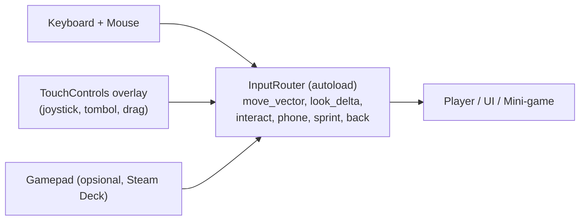

# SEMESTER RECEH — Setup Linux & Pipeline Multiplatform (Windows · Linux · Android)

Seluruh development dilakukan **100% di Linux** oleh Dev 1 & Dev 2. Target rilis: **Windows (x86_64), Linux (x86_64), Android (arm64)**. Dokumen ini adalah panduan teknis; jadwalnya ada di [[07_setup_roadmap_adil_2_dev]].

---

## 1. Keputusan Teknis yang Dikunci Sejak Hari 1

| Keputusan | Pilihan | Alasan |
| :--- | :--- | :--- |
| **Engine** | Godot **4.5.x Stable atau lebih baru** (versi stable terbaru saat Hari 1, lalu **dikunci**) | Godot 4.3 di plan lama terlalu tua untuk syarat Google Play terbaru (target API & dukungan *16 KB page size*). Cek *release notes* Godot sebelum memilih. |
| **Renderer** | **Compatibility** (OpenGL ES 3 / OpenGL 3.3) | Gaya low-poly + palet tidak butuh fitur Forward+. Jangkauan HP Android terluas, laptop iGPU lancar, dan **tampilan sama di ketiga platform**. |
| **Bahasa** | GDScript (static typing) | Tanpa .NET, sehingga ekspor Android/Windows dari Linux lebih sederhana. |
| **Resolusi dasar UI** | 1280 × 720, `stretch_mode = canvas_items`, `aspect = expand` | Satu layout untuk monitor 16:9, 16:10, dan HP 20:9. |
| **Orientasi Android** | Landscape (sensor landscape) | Game first-person. |
| **Input** | Semua aksi lewat **Input Map + `InputRouter`** (lihat §5) | Satu kode gameplay untuk keyboard/mouse, layar sentuh, dan gamepad. |
| **Folder data user** | `application/config/use_custom_user_dir = true`, nama `SemesterReceh` | Lokasi save rapi di semua OS. |
| **Penamaan file** | **huruf kecil semua + snake_case, tanpa spasi** | Linux *case-sensitive*, Windows tidak. `Meja.glb` ≠ `meja.glb` di Linux, sehingga bug ini bisa lolos di satu OS dan crash di OS lain. |

> [!WARNING]
> **Jangan ganti renderer atau versi Godot di tengah proyek.** Uji renderer Compatibility di HP Android terlemah milik tim pada Minggu 1. Jika gagal total, keputusan bisa diubah ke "Mobile" **hanya di Minggu 1**.

---

## 2. Setup Workstation Linux (Wajib Sama untuk Dev 1 & Dev 2)

Contoh perintah untuk **Ubuntu/Debian/Mint**. Padanan Fedora (`dnf`) dan Arch (`pacman`) ada di kolom catatan.

### 2.1 Paket Sistem
```bash
sudo apt update
sudo apt install -y git git-lfs openjdk-17-jdk unzip curl wget \
                    wine64 scrcpy android-sdk-platform-tools-common
git lfs install
```
| Paket | Fungsi | Catatan Distro Lain |
| :--- | :--- | :--- |
| `git`, `git-lfs` | Version control + file besar | Arch: `git git-lfs` · Fedora: `git git-lfs` |
| `openjdk-17-jdk` | Java untuk ekspor Android | Arch: `jdk17-openjdk` · Fedora: `java-17-openjdk-devel`. Ikuti versi JDK yang diminta docs Godot. |
| `wine64` | Smoke test `.exe` Windows + `rcedit` untuk ikon | Arch: `wine` · Fedora: `wine` |
| `scrcpy` | Mirror & rekam layar HP Android ke PC (untuk debug & trailer) | Tersedia di semua distro besar |
| `android-sdk-platform-tools-common` | udev rules agar `adb` mengenali HP tanpa root | Arch: `android-udev` |

Setelah itu: `sudo usermod -aG plugdev $USER` lalu logout/login.

### 2.2 Aplikasi (Unduh Biner Resmi, Jangan dari Repo Distro)
| Aplikasi | Cara Install | Lokasi yang Disepakati |
| :--- | :--- | :--- |
| **Godot 4.5.x Standard** | Unduh `.zip` Linux x86_64 dari godotengine.org | `~/Apps/godot/` (buat `.desktop` launcher) |
| **Export Templates** | Godot → *Editor → Manage Export Templates → Download* (versi harus identik) | Otomatis di `~/.local/share/godot/export_templates/` |
| **Blender 4.2 LTS** | Unduh `.tar.xz` dari blender.org | `~/Apps/blender/` |
| **Android cmdline-tools** | Unduh *Command line tools only (Linux)* dari developer.android.com | `~/Android/Sdk/cmdline-tools/latest/` |
| **butler** (itch.io CLI) | Unduh dari itch.io/docs/butler | `~/Apps/butler/` + tambahkan ke `PATH` |
| **rcedit** (`rcedit-x64.exe`) | Unduh dari GitHub electron/rcedit | `~/Apps/rcedit/` |
| Krita / GIMP, Inkscape, Audacity, OBS | Package manager atau Flatpak | — |

> [!CAUTION]
> **Jangan pakai Godot versi Flatpak/Snap** untuk proyek ini. Sandbox-nya sering memblokir akses ke Android SDK, `adb`, Wine, dan Git. Pakai biner resmi.

### 2.3 Android SDK
```bash
export ANDROID_HOME="$HOME/Android/Sdk"
export PATH="$ANDROID_HOME/cmdline-tools/latest/bin:$ANDROID_HOME/platform-tools:$PATH"
# simpan 2 baris di atas ke ~/.bashrc atau ~/.zshrc

sdkmanager --licenses
# Versi PERSIS (build-tools, platforms, ndk, cmake) ikuti halaman
# "Exporting for Android" di dokumentasi Godot versi yang dipakai. Contoh pola:
sdkmanager "platform-tools" "cmdline-tools;latest" \
           "build-tools;<versi>" "platforms;android-<API>" \
           "ndk;<versi>" "cmake;<versi>"
```

**Keystore:**
```bash
mkdir -p ~/keystores && cd ~/keystores
# Debug (bebas, untuk testing)
keytool -keyalg RSA -genkeypair -alias androiddebugkey -keypass android \
  -keystore debug.keystore -storepass android \
  -dname "CN=Android Debug,O=Android,C=US" -validity 9999 -deststoretype pkcs12
# Release / Upload key (SATU KALI, dibuat Dev 2, disimpan berdua)
keytool -v -genkey -keystore semester_receh_upload.keystore -alias semesterreceh \
  -keyalg RSA -validity 10000
```

> [!CAUTION]
> **Keystore release + password TIDAK BOLEH masuk Git.** Simpan di 2 tempat (password manager bersama + flashdisk). Kehilangan upload key berarti harus mengurus reset ke Google, dan update game di Play Store tertunda.

**Godot Editor Settings → Export → Android:** isi `Java SDK Path` (misalnya `/usr/lib/jvm/java-17-openjdk-amd64`) dan `Android SDK Path` (`~/Android/Sdk`).
**Godot Editor Settings → Export → Windows:** isi `rcedit` (`~/Apps/rcedit/rcedit-x64.exe`) dan `wine` (`/usr/bin/wine`) agar ikon `.exe` bisa diganti dari Linux.

### 2.4 Checklist "Workstation Siap"
- [ ] `godot --version` di kedua laptop menunjukkan string **identik**
- [ ] `git lfs env` berjalan tanpa error
- [ ] `adb devices` menampilkan HP (status `device`, bukan `unauthorized`)
- [ ] Ekspor Android debug → tombol **Remote Deploy** (ikon Android di kanan atas editor) berhasil menjalankan game di HP
- [ ] Ekspor Windows → `wine SemesterReceh.exe` terbuka
- [ ] Ekspor Linux → `./SemesterReceh.x86_64` terbuka
- [ ] Blender bisa ekspor `.glb` dan Godot meng-import tanpa warning skala

---

## 3. Struktur Repositori

```text
semester-receh/                  ← root repo Git
├── game/                        ← proyek Godot (project.godot di sini)
│   ├── autoload/ scenes/ scripts/ data/ assets/   (sesuai [[06_arsitektur_teknis_git]])
│   ├── scripts/platform/        ← InputRouter, PlatformInfo, TouchControls
│   └── export_presets.cfg       ← di-commit (tanpa password)
├── art_source/                  ← .blend, .kra, .xcf, .aup3 (LFS) — TIDAK di dalam game/
├── docs/                        ← semua file MD ini
├── tools/
│   ├── build_all.sh             ← ekspor 3 platform via CLI
│   └── publish_itch.sh          ← upload via butler
├── .github/workflows/build.yml  ← CI (opsional mulai Minggu 14)
├── .gitattributes
├── .gitignore
├── OWNERSHIP.md                 ← daftar pemilik scene/sistem saat ini
└── VERSION                      ← contoh: 0.1.0
```

> [!NOTE]
> File `.blend` sengaja **di luar** folder `game/`. Kalau ditaruh di dalam, Godot akan mencoba meng-import `.blend` secara otomatis (butuh path Blender di Editor Settings), dan hasilnya bisa berbeda di dua laptop.

### 3.1 `.gitattributes`
```gitattributes
* text=auto eol=lf
*.gd     text eol=lf
*.tscn   text eol=lf
*.tres   text eol=lf
*.dialogue text eol=lf

*.glb  filter=lfs diff=lfs merge=lfs -text
*.png  filter=lfs diff=lfs merge=lfs -text
*.ogg  filter=lfs diff=lfs merge=lfs -text
*.wav  filter=lfs diff=lfs merge=lfs -text
*.ttf  filter=lfs diff=lfs merge=lfs -text
*.blend filter=lfs diff=lfs merge=lfs -text
*.kra  filter=lfs diff=lfs merge=lfs -text
*.xcf  filter=lfs diff=lfs merge=lfs -text
```

### 3.2 `.gitignore`
```gitignore
game/.godot/
build/
*.keystore
*.jks
game/android/            # template build Gradle (di-install ulang tiap mesin)
.export_credentials*
*.tmp
```
*Catatan:* Godot 4 menyimpan password ekspor di `game/.godot/export_credentials.cfg`, yang sudah ter-ignore bersama folder `.godot/`.

---

## 4. Export Preset per Platform

| Preset | Output | Pengaturan Penting |
| :--- | :--- | :--- |
| **Linux** | `SemesterReceh.x86_64` + `.pck` (atau embed) → dibungkus `.tar.gz` | `binary_format/architecture = x86_64`, embed PCK = on |
| **Windows Desktop** | `SemesterReceh.exe` (embed PCK) → dibungkus `.zip` | Ikon `.ico` via rcedit, `application/product_name`, `file_version` = `VERSION` |
| **Android (APK)** | `SemesterReceh-x.y.z.apk` | Untuk itch.io & testing. `arm64-v8a` (+ `armeabi-v7a` opsional), screen landscape, immersive on, **tanpa permission tambahan** |
| **Android (AAB)** | `SemesterReceh-x.y.z.aab` | Untuk Google Play. Wajib **Use Gradle Build** (*Project → Install Android Build Template*), `Export Format = AAB`, `target_sdk` sesuai syarat Play terbaru |

**Versi:** `version/code` (Android) naik **+1 setiap build yang diunggah ke Play**; `version/name` = isi file `VERSION`.

### 4.1 Skrip Build Lokal (`tools/build_all.sh`)
```bash
#!/usr/bin/env bash
set -euo pipefail
GODOT="${GODOT:-$HOME/Apps/godot/godot}"
VER="$(cat VERSION)"
cd "$(dirname "$0")/../game"
mkdir -p ../build/{linux,windows,android}

"$GODOT" --headless --export-release "Linux"           "../build/linux/SemesterReceh.x86_64"
"$GODOT" --headless --export-release "Windows Desktop" "../build/windows/SemesterReceh.exe"

# Android release: kredensial via environment variable (tidak disimpan di repo)
: "${GODOT_ANDROID_KEYSTORE_RELEASE_PATH:?set dulu path keystore}"
: "${GODOT_ANDROID_KEYSTORE_RELEASE_USER:?set dulu alias}"
: "${GODOT_ANDROID_KEYSTORE_RELEASE_PASSWORD:?set dulu password}"
"$GODOT" --headless --export-release "Android" "../build/android/SemesterReceh-$VER.apk"

echo "✅ Build $VER selesai di ./build"
```

### 4.2 Upload itch.io (`tools/publish_itch.sh`)
```bash
#!/usr/bin/env bash
set -euo pipefail
VER="$(cat VERSION)"; PROJ="namaakun/semester-receh"
butler push build/linux   "$PROJ:linux"   --userversion "$VER"
butler push build/windows "$PROJ:windows" --userversion "$VER"
butler push build/android "$PROJ:android" --userversion "$VER"
```

### 4.3 CI GitHub Actions (Opsional, Minggu 14)
Kerangka ini berbasis image Docker `barichello/godot-ci` (sesuaikan tag & langkah template dengan README image tersebut):
```yaml
name: build
on:
  push:
    tags: ["v*"]
  workflow_dispatch:
jobs:
  export:
    runs-on: ubuntu-latest
    container: barichello/godot-ci:4.5.1   # HARUS sama dengan versi Godot tim
    strategy:
      matrix:
        preset: ["Linux", "Windows Desktop"]
    steps:
      - uses: actions/checkout@v4
        with: { lfs: true }
      - name: Pasang export templates
        run: |
          mkdir -p ~/.local/share/godot/export_templates
          cp -r /root/.local/share/godot/export_templates/* ~/.local/share/godot/export_templates/ || true
      - name: Export
        run: |
          mkdir -p build
          cd game && godot --headless --export-release "${{ matrix.preset }}" "../build/out"
      - uses: actions/upload-artifact@v4
        with:
          name: ${{ matrix.preset }}
          path: build/
```

> [!WARNING]
> Setiap `checkout` dengan `lfs: true` memakai **kuota bandwidth Git LFS** GitHub. Jalankan CI **hanya saat tag rilis** atau secara manual, jangan di setiap push. Build Android release tetap lebih aman dilakukan **lokal oleh Dev 2** karena butuh keystore.

---

## 5. Input Lintas Platform

### 5.1 Arsitektur

* **Kode gameplay tidak boleh membaca `InputEventKey` atau `InputEventScreenTouch` langsung.** Semua lewat `InputRouter.get_move_vector()`, `InputRouter.consume_look_delta()`, dan action Input Map (`interact`, `phone`, `sprint`, `rotate_item`, `back`).
* `TouchControls` hanya tampil jika `DisplayServer.is_touchscreen_available()` atau jika dipaksa lewat Settings (berguna untuk tes di laptop layar sentuh).

### 5.2 Tabel Pemetaan Kontrol
| Aksi | PC (Keyboard/Mouse) | Android (Sentuh) | Gamepad (Opsional) |
| :--- | :--- | :--- | :--- |
| Gerak | `WASD` | Joystick virtual dinamis (separuh kiri layar) | Stik kiri |
| Lihat | Mouse | Drag di separuh kanan layar | Stik kanan |
| Sprint | `Shift` | Tombol toggle 🏃 | `L3` |
| Interaksi | `E` | Tombol besar kanan bawah, **labelnya berubah sesuai prompt** ("Masuk Kelas") | `A` / `✕` |
| Tahan interaksi | Tahan `E` | Tahan tombol interaksi (ada ring progres) | Tahan `A` |
| Buka HP | `Tab` | Ikon 📱 kanan atas | `Y` / `△` |
| Jeda / Kembali | `Esc` | Ikon ⏸ kiri atas **dan** tombol Back Android | `Start` / `B` |
| Dekor: taruh | Klik kiri | Tap lokasi → tombol ✔ | `A` |
| Dekor: putar | `R` | Tombol ⟳ | `RB` |
| Dekor: batal | Klik kanan | Tombol ✖ | `B` |
| Lanjut dialog | `E` / klik | Tap di mana saja | `A` |
| Percepat dialog | Tahan `E` | Tahan layar | Tahan `A` |
| Kantin & Ujian | Klik | Tap (target minimal 48 dp) | Navigasi D-pad + `A` |
| Debug (build dev) | `F1` | Tap 3 jari | `Select` + `Start` |

### 5.3 Aturan UI Lintas Platform
* Semua UI memakai **anchor/container**, tanpa posisi piksel absolut.
* **Safe area:** HUD & TouchControls membaca `DisplayServer.get_display_safe_area()` agar tidak tertutup notch/punch-hole.
* Ukuran target sentuh minimal **48 dp** (≈ 64 px di 720p). HP UI sudah memakai tombol besar ([[05_ui_ux_audio_visual]]).
* Prompt teks otomatis berubah sesuai perangkat input terakhir: `[E] Masuk Kelas` ↔ `Ketuk Masuk Kelas` ↔ `(A) Masuk Kelas`.
* Settings tambahan per platform:
  * **Desktop:** Fullscreen/Windowed, VSync, batas FPS.
  * **Android:** Render scale (50–100%), ukuran & transparansi kontrol sentuh, sensitivitas drag, kualitas bayangan.

---

## 6. Perilaku Khusus Platform

| Topik | Desktop (Win/Linux) | Android |
| :--- | :--- | :--- |
| **Lokasi save** | Linux: `~/.local/share/SemesterReceh/` · Windows: `%APPDATA%\SemesterReceh\` | Penyimpanan internal app (otomatis) |
| **Autosave** | Pagi + tidur ([[01_visi_prinsip_desain]]) | Pagi + tidur **+ saat app di-minimize** (`NOTIFICATION_APPLICATION_PAUSED`) |
| **Kehilangan fokus** | Jeda otomatis (opsional di Settings) | Selalu jeda + mute saat app di-background |
| **Tombol Back** | — | `NOTIFICATION_WM_GO_BACK_REQUEST` → sama dengan `Esc`. Di Main Menu → konfirmasi keluar |
| **Keluar game** | Menu Keluar | Menu Keluar tetap ada (memanggil `get_tree().quit()`) |
| **Mouse capture** | `Input.MOUSE_MODE_CAPTURED` saat jalan | Tidak dipakai |
| **Layar** | Resolusi bebas | Fullscreen immersive, landscape, layar tidak mati saat main (`keep_screen_on`) |
| **Ukuran build** | Target < 300 MB | APK/AAB target **< 150 MB** |

**Format save:** `user://save_1.json` + `user://save_pre_ending.json` + folder `user://jurnal/` (gambar kecil). Selalu tulis ke file `.tmp` lalu rename, agar save tidak korup jika HP mati mendadak.

---

## 7. Anggaran Performa

| Metrik | Desktop Minimum | Android Minimum |
| :--- | :--- | :--- |
| Perangkat acuan | Laptop iGPU (Intel UHD 620 / Vega 8), RAM 8 GB | HP RAM 3–4 GB, GPU kelas Mali-G52 / Adreno 610 |
| Target FPS | 60 FPS @ 1080p | **30 FPS stabil** (60 jika mampu) @ render scale 75% |
| Segitiga per frame | < 300k | **< 100k** |
| Draw call per frame | < 500 | **< 150** |
| Tekstur | 1 palet 256×256 + ikon UI | Sama (palet bersama sangat membantu batching) |
| Cahaya | 1 Directional + lampu Omni seperlunya | 1 Directional (bayangan resolusi rendah) + maks 2–3 Omni di layar |
| Muat scene | < 3 detik | < 6 detik (pakai `ResourceLoader.load_threaded_request` + layar fade) |

**Teknik wajib:** setiap area (kos, kelas, kantin, sekre, griya) adalah **scene terpisah** yang dimuat saat lewat pintu, sehingga hanya satu interior yang aktif. Prop berulang (kursi kelas, pohon) memakai **MultiMeshInstance3D**. Matikan bayangan untuk prop kecil. Gunakan Godot Profiler + **Remote Debug di HP** setiap gate.

---

## 8. Matriks Pengujian Platform

| Platform | Cara Tes dari Linux | Frekuensi |
| :--- | :--- | :--- |
| **Linux** | Langsung di laptop dev (2 distro berbeda jika kedua dev beda distro = bonus) | Setiap hari |
| **Windows (cepat)** | `wine build/windows/SemesterReceh.exe` | Setiap selesai fitur besar (*smoke test*) |
| **Windows (nyata)** | Laptop teman / lab kampus / partisi dual-boot. **Wine tidak cukup untuk validasi akhir.** | Setiap Gate (M1, M4, M10, M12) + mingguan di Fase 3 |
| **Android** | HP fisik via USB (`adb`, Remote Deploy, `scrcpy`). Minimal **2 HP**: 1 lemah, 1 menengah | Setiap **Jumat (Platform Day)** + setiap Gate |
| **Gamepad / Steam Deck** | Opsional, controller USB di Linux | Fase 3 |

### Checklist per Gate (Copy ke Issue GitHub)
- [ ] Game terbuka di Linux, Windows nyata, Android lemah, Android menengah
- [ ] Gerak & lihat terasa nyaman di mouse **dan** sentuh
- [ ] Semua prompt interaksi bisa dipicu dengan tombol sentuh
- [ ] HP UI terbaca di layar HP 6 inci (teks ukuran "Sedang")
- [ ] Save → tutup paksa app → buka lagi → progres utuh (khusus Android: swipe-kill app)
- [ ] FPS sesuai anggaran §7
- [ ] Tidak ada error `res://` *case mismatch* di log Windows/Android

---

## 9. Distribusi & Rilis

| Kanal | Platform | Format | Catatan |
| :--- | :--- | :--- | :--- |
| **itch.io** | Windows, Linux, Android | `.zip`, `.tar.gz`, `.apk` | Upload via `butler` dari Linux. Rilis paling cepat, bisa sejak *playtest* (halaman restricted). |
| **Google Play** | Android | `.aab` | Akun developer berbayar sekali. **Akun personal baru wajib Closed Testing ≥ 12 tester selama ≥ 14 hari berturut-turut** sebelum boleh rilis Production. Ini masuk ke roadmap (Minggu 14–16). Siapkan juga kebijakan privasi sederhana (game tanpa pengumpulan data), Data Safety form, rating konten (IARC), ikon 512 px, feature graphic 1024×500, dan screenshot. |
| **Steam** (opsional, pasca-rilis) | Windows, Linux (Steam Deck) | Depot | Tidak masuk scope 16 minggu. |

> [!IMPORTANT]
> Aturan Google Play (target API level, page size, jumlah tester) **berubah tiap tahun**. Dev 2 wajib mengecek halaman resmi Play Console pada Minggu 13 dan memperbarui dokumen ini jika ada perbedaan.
